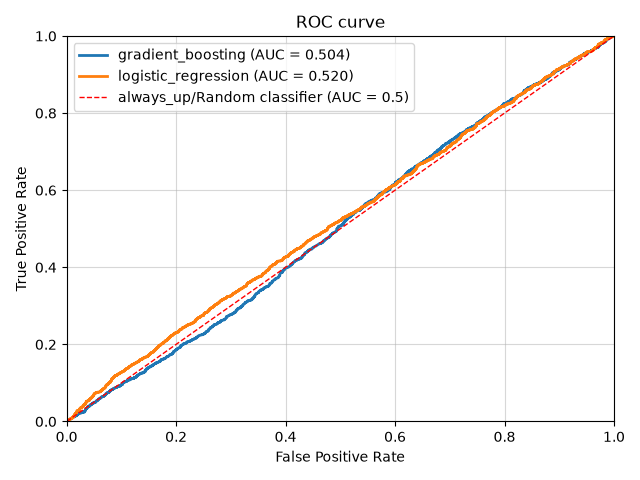

# Stock Movement Predictor

## Overview:
This project predict next day stock direction (up/down) from historical price and technical features, using time aware, walk forward split to ensure no lookahead bias, then compare results against naive baselines. This will be served via a FastAPI endpoint, and dockerised, tested, and version controlled.

## Stock Universe:
Includes 24 liquid large cap US stocks, equally distributed across 4 categories, for 8 years of continuous daily OHLCV data. (Trading days from 1st January 2018 to 31st December 2025, inclusive)

| Field | Tickers |
| --- | --- |
| Tech (x6) | NVDA, AAPL, MSFT, AMD, GOOGL, META |
| Automotive / industrial (x6) | F, GM, CAT, BA, TSLA, RACE |
| Finance (x6) | JPM, GS, V, MA, BAC, WFC |
| Consumer (x6) | NKE, MCD, SBUX, KO, PEP, DIS |

## Features
Engineered from daily OHLCV, only using data available on or before their respective dates.

I used the following features:
- [1, 5, 10, 20] day windows: ROC, VROC
- [5, 10, 20] day windows: Disparity Index (MA's ratio), rolling volatility
- 14 day window: ATR%, RSI, Stochastic %K and %D
- 25 day window: Aroon up/down

| Category | Features | What |
| --- | --- | --- |
| Momentum (x7) | `return_*d`, `rsi_14d`, `stoch_k_14d`/`stoch_d_14d` | Shows short/medium term direction (velocity) of price |
| Trend (x5) | `ma_ratio_*d`, `aroon_up_25d`/`aroon_down_25d` | How current value stands against the general trend (direction) of previous prices | 
| Volatility (x4) | `volatility_*d`,  `atr_pct_14d` | How much current prices varies from recent prices, how turbulent (varied) trading has been. More of a reassurance indicator | 
| Volume (x4) | `volume_change_*d`  | Helps confirm movement | 

You can find my rough learning notes including derivations, formulas, and interpretations here: [`features_notes.md`](./notebooks/notes/features_notes.md)

## Walk forward validation (Time Series Split)

The function `walk_forward_splits()`, performs time series split on unique training dates and not raw dataframe rows, so no single date is split across train and test. Then, finds the row position index of those dates, which is usable with `.iloc` later.

### Why use Time Series Split, and not other cross validations:
Normal k-fold or shuffled 80/20 split, relies on the fact that rows are independent of order and can occur (be placed) anywhere.

But this data is time dependent, because a row from March can only exist after events represented by rows from January and February have already happened.

This means shuffling or k-fold split would mean training on later dates, and testing on earlier dates. This lets the model learn from information that wouldn't be available at the date the test prediction was supposedly made.

Essentially, the validation score could give a misleading optimistic estimate of how well the model would generalise to real future data.

So, instead of those, we use walk forward validation via TimeSeriesSplit, which guarantees all training dates come before any testing dates.

Additionally, I chose to use have gap = 25, where gap is purge/embargo between train and test, because not only does it solve lookahead bias that occurs if gap was set to the default of 0, but it also separates test set's rolling window with that of train's (The features' largest lookback window is 25). This reduces dependency and optimistic bias. 

You can find my notes including an explained walkthrough of `walk_forward_split()`, TimeSeriesSplit explanation, and gap justification here: [`walk_forward_cv_notes.md`](./notebooks/notes/walk_forward_cv_notes.md)

## Models
I've used 2 models to compare against the baselines:
- **Logistic regression**: A linear model (standardised before fitting)
- **Gradient Boosting**: A non-linear model

### Baselines:
Baseline dummy models to compare machine learning models against.

**Always predict up**: It always predicts that tomorrow's close is higher than today's, literally `np.ones(n, dtype=int)`.

**Buy and hold**: Buy on `start_date` and sell on `end_date`. Calculate the return for each stock, then return the equally weighted mean.

You can find my explanations, justifications, and notes of alternative popular models other than Logistic Regression and Gradient Boosting, including Naive Bayes, SVM, and Random Forest, here: [`modelling_notes.md`](./notebooks/notes/modelling_notes.md)

## Results/Evaluation

### Methodology
Firstly, the dataset was split into 2:
- **Development df**: everything up to 2025-01-01 (exclusive), minus purge gap (25) days 
- **Testing df**: everything after 2025-01-01 (inclusive), hold this one out for final generalisation test

Then, the evaluation process is as follows:
1. **Training/Validation**: using development df, use walk forward cross validation to find and tune best models/parameters (or not, see below)
2. **Testing**: With the chosen models and their parameters, train on the entire development df, test on testing df and get results.

Several graphs and csvs were created to visualise the effectiveness of Logistic regression, Gradient Boosting, and Always Up.

### Summary of findings
In general, neither Logistic Regression nor Gradient Boosting emerged victorious. They failed to show consistent and meaningful improvement over Always Up, across the main metrics.

The model's results provides little evidence of robust and exploitable, daily directional signals from the features under this particular setup.

#### For Training/Validation (walk forward validation + parameter sweeps):
- ROC AUC remained close to 0.50 for all models, suggesting weak or no useful daily directional features were found.

- In parameter sweeps, they showed some changes to recall and F1 scores, but did not improve ROC AUC meaningfully, suggesting different configurations changed classification behaviour (e.g. underfitting/bias), without meaningfully improving ranking information:

- For example, lowering `max_leaf_nodes` to 7, showed higher recall results than default parameters, but ROC AUC stayed the same, showing that its ranking ability has not improved.

#### For Testing (held out (2025) testing):

| model | accuracy | roc_auc | precision | recall | f1 |
| --- | --- | --- | --- | --- | --- |
| logistic_regression | 0.526 | 0.520 | 0.529 | 0.882 | 0.662 |
| gradient_boosting | 0.527 | 0.504 | 0.532 | 0.816 | 0.644 |
| always_up | 0.525 | 0.500 | 0.525  | 1.000 | 0.689 |

The graph shows that all models trail around AUC 0.5 diagonal line.

- Logistic Regression showed higher ROC AUC than the rest, but that is not necessarily supported by validation sections, therefore it is not empirical evidence that Logistic Regression is better at classification in this use case.

- Logistic Regression's coefficients suggests a weak short term mean reversion relationship, with features Stochastic %K and %D, and ROC features `return_1d` and `return_5d`, although this should not be interpreted as empirical evidence that these indicators will generalise well for real world applications.

#### Buy and Hold, equally weighted mean
Across the stock universe, over the entire testing period (2025), Buy and Hold shows a return of +25.99%, showing that profitability of the stock universe does not necessarily need daily directional classification.

### Additional Readings

You can find my detailed analysis, comprehensive results tables, plots, and interpretations of all results, walk forward cross validation, parameter sweeps, test set performance, for Logistic Regression, Gradient Boosting, and Always Up, here: [`results_notes.md`](./notebooks/notes/results_notes.md)

Additionally, you can find a refresher on metrics used for evaluations here: [`scores_refresher_notes.md`](./notebooks/notes/scores_refresher_notes.md)
