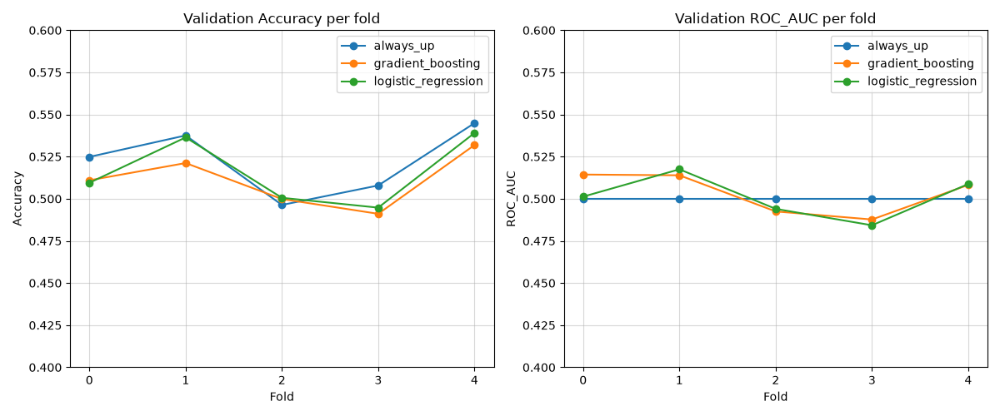
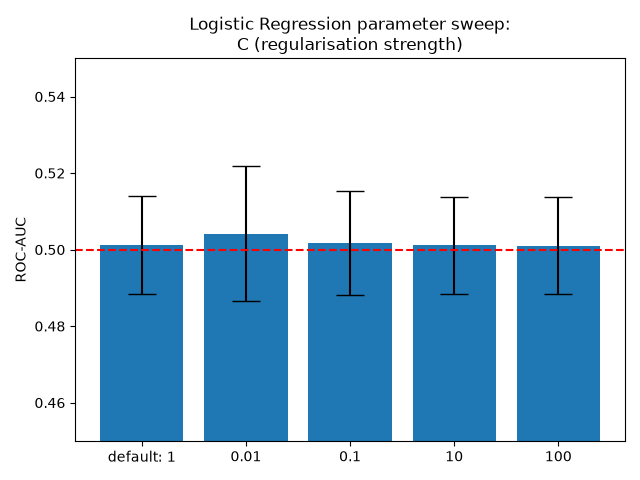
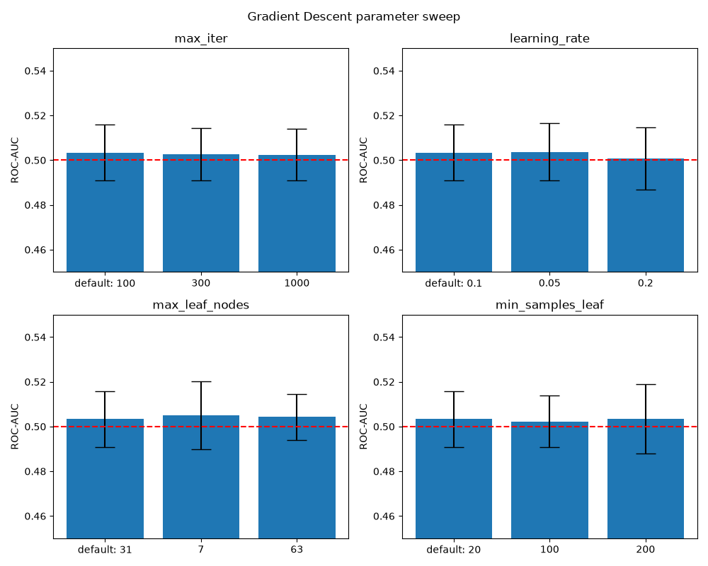
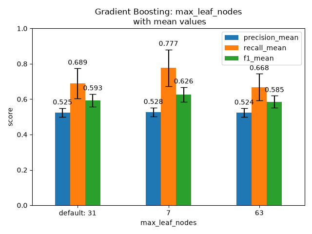
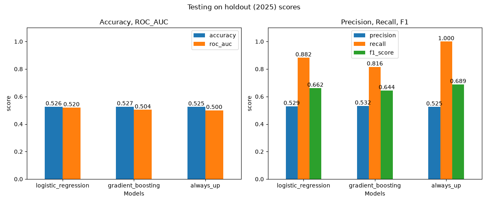
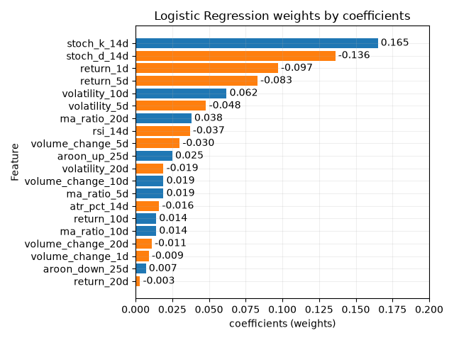

# Results/Evaluation
## Models
I've used 2 models to compare against the baselines:
- **Logistic regression**: A linear model (standardised before fitting)
- **Gradient Boosting**: A non-linear model

## Methodology
Firstly, the dataset was split into 2:
- **Development df**: everything up to 2025-01-01, minus purge gap (25) days 
- **Testing df**: everything after, hold this one out for final generalisation test

Then, the evaluation process is as follows:
1. **Training/Validation**: using development df, use walk forward cross validation to find and tune best models/parameters (or not, see below)
2. **Testing**: With the chosen models and their parameters, train on the entire development df, test on testing df and get results.

Several graphs and csvs were created to visualise the effectiveness of Logistic regression, Gradient Boosting, and Always Up.

## Validation 
Using only development df, 2018-2024 (with a gap of 25 trading days before test df), for 5 fold walk forward.

### Cross validation results: (mean ± std)

| model | accuracy | roc_auc | precision | recall | f1 |
| --- | --- | --- | --- | --- | --- |
| always_up | 0.522 ± 0.020 | 0.500 ± 0.000 | 0.522 ± 0.020 | 1.000 ± 0.000 | 0.686 ± 0.017 |
| gradient_boosting | 0.511 ± 0.016 | 0.503 ± 0.012 | 0.525 ± 0.025 | 0.689 ± 0.086 | 0.593 ± 0.036 |
| logistic_regression | 0.516 ± 0.020 | 0.501 ± 0.013 | 0.525 ± 0.024 | 0.789 ± 0.074 | 0.629 ± 0.031 |

For accuracy, both models trailed Always Up, but are slightly underperforming.

The Always Up baseline has an AUC of 0.50 because always assigns positive (up) to every observation.

For ROC AUC, overall, no models show a meaningful lead, showing that both models are effectively guessing at random, as they both sit around 0.5. This indicates that there is little to no evidence of useful ranking between positive (up) and negatives (down). 

This shows that both models are not more capable of differentiating positive (up) and negative (down) than Always Up, which doesn't do that at all.

Both models dip slightly above Always Up at fold 0, 1, and 4 (1st, 2nd, 5th folds). Both models also dip slightly below 0.5 at fold 2-3 (3rd, 4th folds). This is expected and within sampling variations.

It is important to note that, the ROC AUC is nearly indistinguishable from 0.5, which is as effective as always_up/random guessing. 

For f1, Always Up takes the lead, which is expected given its recall will always be 1, inflating the score. However, Gradient Boosting and Logistic Regression are not too far behind. They have near identical precision, but for recall, Logistic Regression catches about 10% more positives (ups) than Gradient Boosting despite having near identical ROC AUC score. 

This shows that Logistic Regression is biased more on predicting positive, and that, more complex model does not necessarily mean better catch rate.

In summary, a single metric alone is not sufficient for model evaluation and decision making. For example, Always Up scores well on accuracy, despite never differentiating between classes.

Regardless of whether the model is linear or non-linear, it seems that they do not perform much better than Always Up, if at all.

It suggests that the models did not find strong robust, exploitable daily directional signal.

It is important to note that, accuracy and ROC AUC scores are extremely tight with small 3dp difference, meaning that the models are performing nearly identically, being on par with naive baseline Always Up.

## Parameter sweep
Additionally, a parameter sweep was conducted in an attempt to tune for better performance.

### Logistic Regression
Comprehensive table of results across metrics: (mean ± std)
| parameter | param_value | accuracy | roc_auc | precision | recall | f1 |
| --- | --- | --- | --- | --- | --- | --- |
| C | (default) 1 | 0.516 ± 0.020 | 0.501 ± 0.013 | 0.525 ± 0.024 | 0.789 ± 0.074 | 0.629 ± 0.031 |
| C | 0.01 | 0.519 ± 0.022 | 0.504 ± 0.018 | 0.526 ± 0.025 | 0.814 ± 0.058 | 0.638 ± 0.027 | 
| C | 0.1 | 0.517 ± 0.021 | 0.502 ± 0.014 | 0.525 ± 0.025 | 0.793 ± 0.072 | 0.631 ± 0.031 |
| C | 10 | 0.516 ± 0.021 | 0.501 ± 0.013 | 0.525 ± 0.025 | 0.788 ± 0.074 | 0.629 ± 0.031 |
| C | 100 | 0.516 ± 0.021 | 0.501 ± 0.013 | 0.525 ± 0.025 | 0.788 ± 0.074 | 0.629 ± 0.031 |

In sklearn, L2 regularisation strength is $\lambda = \frac{1}{C}$, so smaller C means stronger regularisation.

Testing regularisation strength across various numbers shows no meaningful improvement, the results are basically identical across the board.

At C = 10, 100, regularisation strength is so small, that the solution approaches unregularised log likelihood solution. This explains their identical results (to 3dp) across the metrics.

The most intresting result is strongest regularisation (C=0.01), which has the best recall (+2.5%) compared to default:

A Logistic Regression with large penalty (small C) makes it underfit (biased), as all its weights are much closer to 0 (in $\sigma(prediction)$, when weights are small, it tends prediction to intercept baseline), meaning the features themselves are not being considered as much, and in this case, making it predict positive (up) more, and improving recall without improving accuracy or ROC AUC.

However, ROC AUC and precision stays the same, showing that the model's ranking ability has not improved.

This shows that regularisation is having no meaningful effect on model performance. In other words, regularisation strength cannot save the model if there is nothing to regularise to. (The weights/coefficients are already small, see Logistic regression coefficients in the tests section below)

### Gradient Boosting
Comprehensive table of results across metrics: (mean ± std)

Default parameters are:\
\- max_iter=100\
\- learning_rate=0.1\
\- max_leaf_nodes=31\
\- min_samples_leaf=20

| parameter | param_value | accuracy | roc_auc | precision | recall | f1 |
| --- | --- | --- | --- |---| --- | --- |
|  | default | 0.511 ± 0.016 | 0.503 ± 0.012 | 0.525 ± 0.025 | 0.689 ± 0.086 | 0.593 ± 0.036 |
| max_iter | 300 | 0.510 ± 0.017 | 0.503 ± 0.012 | 0.524 ± 0.025 | 0.684 ± 0.096 | 0.590 ± 0.042 |
| max_iter | 1000 | 0.510 ± 0.017 | 0.502 ± 0.012 | 0.524 ± 0.025 | 0.681 ± 0.101 | 0.589 ± 0.044 |
| learning_rate | 0.05 | 0.519 ± 0.016 | 0.504 ± 0.013 | 0.528 ± 0.023 | 0.739 ± 0.100 | 0.613 ± 0.041 |
| learning_rate | 0.2 | 0.507 ± 0.019 | 0.501 ± 0.014 | 0.523 ± 0.029 | 0.657 ± 0.070 | 0.580 ± 0.030 |
| max_leaf_nodes | 7 | 0.520 ± 0.021 | 0.505 ± 0.015 | 0.528 ± 0.025 | 0.777 ± 0.104 | 0.626 ± 0.042 |
| max_leaf_nodes | 63 | 0.509 ± 0.015 | 0.504 ± 0.010 | 0.524 ± 0.025 | 0.668 ± 0.076 | 0.585 ± 0.034 |
| min_samples_leaf | 100 | 0.512 ± 0.014 | 0.502 ± 0.011 | 0.525 ± 0.023 | 0.699 ± 0.087 | 0.597 ± 0.038 |
| min_samples_leaf | 200 | 0.512 ± 0.017 | 0.503 ± 0.016 | 0.526 ± 0.027 | 0.674 ± 0.067 | 0.589 ± 0.030 |

Similar story as Logistic Regression, across the board for Gradient Boosting on the main hyperparameters, providing virtually identical results within small variation. 

This reiterates that there is no robust underlying features that are exploitable.

However one interesting metric is when `max_leaf_nodes` = 7, where its recall is the highest in the parameter sweep, it is nearly 10% better than default.

Placing `max_leaf_nodes` at 7 is significantly smaller than the default 31, meaning the gbm is much shallower. A shallower gbm has less opportunity to "learn", so it actually shows off underfitting (bias), meaning the features themselves are not being considered as much, and in this case, making it predict positive (up) more, and improving recall without improving accuracy or ROC AUC.

However, ROC AUC and precision stays the same, showing that the model's ranking ability has not improved.

### Conclusion
Parameter sweeps showed steady ROC AUC = 0.5 score shows that there is little evidence of useful information during walk forward validation, accuracy and precision stays at around the same as baseline, but recall is the only thing that meaningfully changes across configurations. 

In short, parameter sweeping shows that models can behave differently with different parameters without ever having better ranking scores.

Given that assessing just one parameter at a time does not provide meaningful performance uplifts, there is no need for conducting further grid/cross parameter. Therefore, I resorted back to default parameters for tests rather than choosing hyperparameters based on small noisy differences.

## Test
Using the whole dataset, training on development (2018-2024) and testing on test (2025).

| model | accuracy | roc_auc | precision | recall | f1 |
| --- | --- | --- | --- | --- | --- |
| logistic_regression | 0.526 | 0.520 | 0.529 | 0.882 | 0.662 |
| gradient_boosting | 0.527 | 0.504 | 0.532 | 0.816 | 0.644 |
| always_up | 0.525 | 0.500 | 0.525  | 1.000 | 0.689 |

Similar story reoccurs here, except results are even tighter (except Logistic Regression), meaning that models are performing even more identically to each other. 

An exception being Logistic Regression, which is noticeable increase in ROC AUC compared to cross validation. 

### ROC curve:

ROC curve shares the same story, that the models are performing at near random with minor drifts, and with Logistic Regression showing to be consistently just above Always Up.

Gradient Boosting dipping below and above ROC curve, and netting to ROC AUC of ~0.50 overall, suggest that, there is no real consistent ranking information.

Logistic Regression sits modestly but consistently above the diagonal, matching its slightly higher ROC AUC (0.520) result compared to walk forward validation (0.501). This suggests that there is ranking information/signals buried, albeit very weak.

This is the highest number to appear for ROC AUC anywhere, but because this is a single evaluation that cross validation does not necessarily support, it is not empirical evidence that Logistic Regression is better at classifying positives and negatives compared to other models.

### Logistic Regression feature weights:
All 20 features' coefficients (weights) are plotted, colours blue for positive and orange for negative:

Stochastic %K has highest positive weight (0.165), and Stochastic %D has highest negative weight (-0.136). This means that, higher %K pushes the model into predicting positive (up) more, and lower %D pushes the model into predicting negative (down) more.

Meaning, in the 14 day window, if today's close is relatively high (stochastic %K), but %K' 3 day average is relatively low (stochastic %D), it is more likely to predict positive (up).

A likely explanation is, this discrepancy is at its largest around a recent %K crosses over %D, and when %K crosses over %D, it is usually seen as a bullish signal. However, this is not definitive evidence that the model has learnt this specific crossover effect, because the plot only shows separate contributions of %K and %D.

The Rate of Change features `return_1d` and `return_5d`, also have higher negative weights (-0.097, -0.083), compared to the remaining features. This means higher returns in those windows actually reduces the model's predicted probability of positive (up). 

This seems more aligned with short term mean reversion relationship (after a strong short burst of return, prices are likely to revert back), rather than with momentum continuation (prices likely to go up if it already has been going up).

This doesn't necessarily contradict stochastic %K/%D findings above, as they both measure different aspects of recent price behaviour. Stochastic %K/%D asks where the current price sits within its high-low range in the window, and `return_1d`/`return_5d` is the magnitude of recent price change.

It is also important to note that the coefficients suggest only weak relationships for the features and the predictions, and the patterns found by Logistic Regression are based on this particular stock universe and training/testing windows. Therefore, it is not empirical evidence that Stochastic %K or %D, or `return_1d`/`return_5d` are the best indicators in real world applications.

### Buy and Hold:
Buy and Hold showed a return of equally weighted mean across the stock universe, over the entire period, of +25.99%, showing that a naive buy and hold strategy would be profitable over this window, regardless of any daily directional predictions.

## Final Conclusion

On walk forward validation, neither Logistic Regression nor Gradient Boosting appears victorious over naive baseline Always Up. They performed nearly equivalently at ROC AUC, slightly above Always Up. This strongly suggesting that there is no robust daily direction signal to exploit for classification.

In parameter sweep, the only situation where models seem to have a very slight edge over its default parameters, is in recall, and occurs when models are underfit (biased), or when they are "learning less", therefore predicting to a class more. Additionally, it shows that models behave differently with different parameters without having better ranking scores.

On held out 2025 tests, accuracy remained very similar across the approaches. Logistic Regression showed the highest ROC AUC (0.520), compared to Gradient Boosting (0.504) and Always Up (0.500). However this single evaluation is not sufficient evidence that this is a robust model/improvement over walk forward validation, particularly given that in validation, Logistic Regression results remained at around 0.50.

The Logistic Regression's test coefficients suggests, albeit weakly, that what it has learnt seems more aligned with short term mean reversion relationship, with stochastic %K/%D and `return_1d`/`return_5d` having larger absolute weight than rest of the features. This is not empirical evidence that they are the best indicators in real world applications.

The results show that models did not find strong evidence of robust, exploitable daily directional signals, under this modelling and validation setup.
